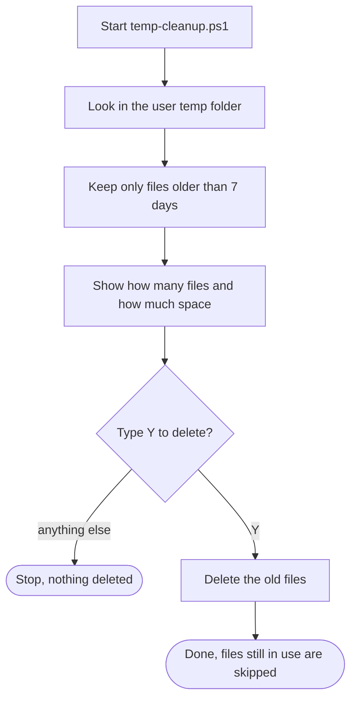

# PowerShell Toolkit

Three small PowerShell scripts for checking and maintaining a Windows 11 laptop. Built as project 23 of my 25-project IT skills tracker, alongside my [Homelab v2](https://github.com/SuperDidZero/homelab-v2) build.

| Script | What it does | Changes anything? |
| --- | --- | --- |
| `health-report.ps1` | Prints the computer name, Windows version and build, uptime, and free space on every drive | No, read only |
| `hardening-check.ps1` | Checks Defender real-time and tamper protection, virus definition date, all three firewall profiles, UAC, the last installed update, and which user accounts are enabled | No, read only |
| `temp-cleanup.ps1` | Finds files in the user temp folder older than 7 days, shows the count and size, and deletes them only after you type Y | Yes, after confirmation |

## How the cleanup stays safe

Only one script changes anything, and it never deletes without asking first:



## How to use

1. Download the scripts into a folder, for example `C:\Users\<you>\Toolkit`.
2. Open Terminal (right-click Start, then Terminal).
3. Allow your own scripts to run, once per user account:

   ```powershell
   Set-ExecutionPolicy -Scope CurrentUser RemoteSigned
   ```

4. Go to the folder and run a script:

   ```powershell
   cd $HOME\Toolkit
   .\health-report.ps1
   ```

Scripts downloaded from the internet are marked as blocked by Windows. Read them first, then unblock with `Unblock-File .\health-report.ps1`.

## Example output

```
=== Health report ===
Computer:  LAPTOP
Windows:   Microsoft Windows 11 Home build 26300
Uptime:    0 days, 2 hours

Drives:

DriveLetter Label       FreeGB SizeGB
----------- -----       ------ ------
          A HDD          144.2  232.9
          C Windows-SSD   30.7    237
```

## Notes

- Tested on Windows 11 Home with Windows PowerShell 5.1.
- `hardening-check.ps1` reports settings, it does not change them.
- `temp-cleanup.ps1` skips any file that is still in use.
